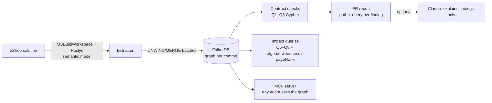

# Ripple

**Ripple finds the bugs your compiler can't: cross-service contract breaks in event-driven .NET.**

> *The diff is 3 lines. The blast radius is 3 handlers in 2 other services.*

Ripple is a pull-request review agent. It turns a .NET solution into a semantic code graph with Roslyn, stores it in
[FalkorDB](https://www.falkordb.com/), and traverses outward from a change to everything it can break — including
services that are only connected through a message bus. Every finding it reports carries the graph path that proves it
and the Cypher query that produced it.

Built for the [FalkorDB "Graph Hacks" hackathon](https://www.wemakedevs.org/hackathons/falkordb) (WeMakeDevs, Oct 2026).

---

## The problem

In [dotnet/eShop](https://github.com/dotnet/eShop) — Microsoft's reference microservices app — services talk through
integration events on RabbitMQ. Each service declares **its own copy** of every event it publishes or consumes:

```csharp
// Ordering.API — the publisher
public record OrderStockItem { public int ProductId { get; } public int Units { get; } ... }

// Catalog.API — a consumer, a different type in a different assembly
public record OrderStockItem(int ProductId, int Units);
```

The bus routes by the event's class name (`@event.GetType().Name`) and System.Text.Json matches fields by name. Nothing
ties the two `OrderStockItem` types together at compile time. So this PR to Ordering:

```diff
-    public int Units { get; }
+    public int Quantity { get; }
```

builds green and passes every unit test, and nothing in the diff mentions Catalog or Webhooks. At run time
(the consumer's `Units` silently deserialises to 0):

- **Catalog.API** stock validation (`AvailableStock >= Units`) confirms every order → the shop oversells.
- **Catalog.API** paid handler calls `RemoveStock(0)`, which throws; the event bus logs a warning and acks the message
  anyway → every paid order is dropped and stock never goes down.
- **Webhooks.API** forwards the paid event to external subscribers with `Units: 0`.

Ripple's comment on that PR (first of three findings, verbatim from `ripple analyze --markdown`):

```
### 1. `Catalog.API` — reads a field `OrderStatusChangedToAwaitingValidationIntegrationEvent` no longer sends

Graph path:
(Ordering.API) OrderStatusChangedToAwaitingValidationDomainEventHandler.Handle()
  -[:PUBLISHES]-> (:EventShape Ordering.API)
  -[:SHAPE_OF]-> (:EventContract {name: 'OrderStatusChangedToAwaitingValidationIntegrationEvent'})
  <-[:SHAPE_OF]- (:EventShape Catalog.API)
  <-[:HANDLES]- (Catalog.API) OrderStatusChangedToAwaitingValidationIntegrationEventHandler.Handle()
  -[:READS]-> (:Property {path: 'OrderStockItems[].Units'})  (missing in publisher's copy)
severity high · produced by `Q1 dangling reads` · publisher OrderStatusChangedToAwaitingValidationDomainEventHandler.cs:23 · consumer OrderStatusChangedToAwaitingValidationIntegrationEventHandler.cs:20
```

The full comment is in [`docs/sample-comment.md`](docs/sample-comment.md). A diff-only review has nothing to point at,
and neither has a plain call graph: there is no call edge from Ordering to
Catalog. The coupling only exists in the contract layer, which is what Ripple models.

---

## How it works



1. **Extract.** `MSBuildWorkspace` loads every deployable project (7 services + 7 libraries in eShop). A two-pass
   Roslyn walker emits structure (services, files, types, methods, calls) and the **contract layer**: each service's
   copy of each integration event as an `EventShape`, joined to a shared `EventContract` keyed by the routing name, with
   every field flattened to its JSON wire path (`OrderStockItems[].Units`, honouring `[JsonPropertyName]`,
   `[JsonIgnore]`, `[JsonInclude]`). `READS` edges come from the semantic model anywhere in the consuming service;
   `FORWARDS` marks handlers that hand the whole event to an untyped parameter (serialisation). Calls through
   interfaces, MediatR commands and MediatR domain events are added as `inferred` edges.
2. **Store.** Batched `UNWIND $rows … MERGE` writes into a staging graph, derived structure is computed in the graph
   (service projection + algorithm scores), then the staging graph is atomically `RENAME`d into place.
3. **Review a PR.** `ripple analyze` indexes the merge-base and the head commit into **two graphs**
   (`eshop@<sha>.<extractor build>`, cached), runs the same checks on both and reports what is new in head.
4. **Explain (optional).** One Claude call (`claude-opus-5-5`, structured JSON output) writes prose around the findings.
   It receives the numbered findings and the diff; explanations for findings the graph did not return are dropped, and
   the report always renders findings and paths from the graph. Without `ANTHROPIC_API_KEY` the text is a template.
5. **Cascades.** Derived `TRIGGERS` edges fold each contract path into one hop, so "what runs because of this method,
   in every service" is a single variable-length `CALLS|TRIGGERS` traversal (Q9).
6. **Agents.** An MCP server exposes the same queries as tools, so Claude Desktop / Claude Code / any MCP client can
   ask "what breaks if I change this field?".

---

## Graph data model

One FalkorDB graph per repository and commit.

### Nodes

| Label | Key (`key`) | Other properties | Layer |
|---|---|---|---|
| `Service` | assembly name | `name`, `kind` (`service`/`library`), `bridgeScore`, `dependencyRank` | code |
| `File` | repo-relative path | `path` | code |
| `Type` | `{assembly}\|{fqn}` | `fqn`, `name`, `kind`, `service`, `file` | code |
| `Method` | `{assembly}\|{fqn(params)}` | `fqn`, `name`, `signature`, `type`, `service`, `file`, `startLine`, `endLine`, `isPublic` | code |
| `EventContract` | event class name (= RabbitMQ routing key) | `name` | contract |
| `EventShape` | `{assembly}\|{event fqn}` — one service's copy | `fqn`, `name`, `service`, `file`, `line`, `unboundParams` | contract |
| `Property` | `{shape key}\|{json path}` | `path`, `name`, `type`, `wireType`, `jsonKind`, `settable`, `depth`, `file`, `line` | contract |

### Relationships

| Pattern | Meaning |
|---|---|
| `(Service)-[:CONTAINS]->(File)-[:DECLARES]->(Type)-[:HAS_METHOD]->(Method)` | structure |
| `(Type)-[:IMPLEMENTS {source}]->(Type)` | interfaces and base types inside the solution |
| `(Method)-[:CALLS {source, via}]->(Method)` | direct calls (`syntactic`); interface dispatch, MediatR `Send`/`Publish` and domain events (`inferred`, `via`) |
| `(Method)-[:PUBLISHES {line}]->(EventShape)` | the method creates the integration event |
| `(Method)-[:HANDLES]->(EventShape)` | `Handle` of an `IIntegrationEventHandler<T>` |
| `(Service)-[:SUBSCRIBES {handler}]->(EventContract)` | `eventBus.AddSubscription<TEvent, THandler>()` |
| `(EventShape)-[:SHAPE_OF]->(EventContract)` | a service's copy of a contract |
| `(EventShape)-[:HAS_PROPERTY]->(Property)` | the copy's JSON fields, nested paths flattened |
| `(Method)-[:READS {line, context}]->(Property)` | code reads the field (`context: log` inside logging calls) |
| `(Method)-[:FORWARDS {line, to}]->(EventShape)` | the whole event goes to an `object`/generic parameter |
| `(Type)-[:DEFINES_SHAPE]->(EventShape)` | the event's type node |
| `(Method)-[:TRIGGERS {contracts}]->(Method)` | derived: publisher → handler in another service, for cascade traversal |
| `(Service)-[:DEPENDS_ON {contracts, weight}]->(Service)` | derived projection for graph algorithms |

On eShop: 1,786 nodes and about 2,500 edges, extracted and written in about 20 seconds.

---

## The order saga, recovered from code

Nothing in eShop declares its order workflow in one place: it emerges from handlers, MediatR commands, domain events
and integration events spread over five services. One Ripple query (Q9, `event_cascade` over MCP) recovers it, starting
from OrderProcessor's grace-period job:

| hops | service | handler |
|---|---|---|
| 1 | Ordering.API | GracePeriodConfirmedIntegrationEventHandler |
| 2 | Ordering.API | SetAwaitingValidationOrderStatusCommandHandler |
| 4 | Ordering.API | OrderStatusChangedToAwaitingValidationDomainEventHandler |
| 5 | Catalog.API, WebApp | OrderStatusChangedToAwaitingValidationIntegrationEventHandler |
| 6 | Ordering.API | OrderStockConfirmed / OrderStockRejected IntegrationEventHandler |
| 7 | Ordering.API | SetStockConfirmed / SetStockRejected OrderStatusCommandHandler |
| 9 | Ordering.API | OrderStatusChangedToStockConfirmedDomainEventHandler |
| 10 | PaymentProcessor, WebApp | OrderStatusChangedToStockConfirmedIntegrationEventHandler |
| 11 | Ordering.API | OrderPaymentSucceeded / OrderPaymentFailed IntegrationEventHandler |
| 12 | Ordering.API | SetPaidOrderStatusCommandHandler, CancelOrderCommandHandler |
| 14 | Ordering.API | OrderStatusChangedToPaidDomainEventHandler, OrderCancelledDomainEventHandler |

The hop from the first handler to Catalog alone is seven edges: `CALLS:mediatr` → `CALLS` → `CALLS:domain-event` →
`PUBLISHES` → `SHAPE_OF` → `SHAPE_OF` ← `HANDLES`. This is the traversal a diff, a grep or an in-process call graph
cannot do, and what the contract checks build on.

---

## Cypher queries and graph algorithms

These are the exact strings in [`RippleQueries.cs`](src/Ripple.Core/Queries/RippleQueries.cs) (regenerate this section
with `ripple queries`).

<!-- QUERIES:BEGIN -->
#### `RippleQueries.DanglingReads`

```cypher
MATCH (pub:Method)-[:PUBLISHES]->(ps:EventShape)-[:SHAPE_OF]->(c:EventContract)<-[:SHAPE_OF]-(cs:EventShape)<-[:HANDLES]-(h:Method)
WHERE ps <> cs AND ($contract IS NULL OR c.name = $contract)
WITH pub, ps, c, cs, h
MATCH (h)-[:CALLS*0..3]->(r:Method)-[rd:READS]->(cp:Property)<-[:HAS_PROPERTY]-(cs)
WHERE rd.context <> 'log' AND NOT (ps)-[:HAS_PROPERTY]->(:Property {path: cp.path})
RETURN DISTINCT 'dangling-read' AS kind, c.name AS contract, pub.service AS publisherService, pub.fqn AS publisher,
       h.service AS consumerService, h.fqn AS handler, r.fqn AS reader, cp.path AS path, cp.wireType AS expected, null AS actual,
       pub.file AS publisherFile, pub.startLine AS publisherLine, r.file AS readerFile, rd.line AS readerLine
ORDER BY contract, consumerService, path
```

#### `RippleQueries.DanglingForwards`

```cypher
MATCH (pub:Method)-[:PUBLISHES]->(ps:EventShape)-[:SHAPE_OF]->(c:EventContract)<-[:SHAPE_OF]-(cs:EventShape)<-[:HANDLES]-(h:Method)
WHERE ps <> cs AND ($contract IS NULL OR c.name = $contract)
WITH pub, ps, c, cs, h
MATCH (h)-[:CALLS*0..3]->(r:Method)-[fw:FORWARDS]->(cs)-[:HAS_PROPERTY]->(cp:Property)
WHERE NOT (ps)-[:HAS_PROPERTY]->(:Property {path: cp.path})
RETURN DISTINCT 'dangling-forward' AS kind, c.name AS contract, pub.service AS publisherService, pub.fqn AS publisher,
       h.service AS consumerService, h.fqn AS handler, r.fqn AS reader, cp.path AS path, cp.wireType AS expected, null AS actual,
       pub.file AS publisherFile, pub.startLine AS publisherLine, r.file AS readerFile, fw.line AS readerLine
ORDER BY contract, consumerService, path
```

#### `RippleQueries.TypeDrift`

```cypher
MATCH (pub:Method)-[:PUBLISHES]->(ps:EventShape)-[:SHAPE_OF]->(c:EventContract)<-[:SHAPE_OF]-(cs:EventShape)<-[:HANDLES]-(h:Method)
WHERE ps <> cs AND ($contract IS NULL OR c.name = $contract)
WITH pub, ps, c, cs, h
MATCH (cs)-[:HAS_PROPERTY]->(cp:Property)
WITH pub, ps, c, cs, h, cp
MATCH (ps)-[:HAS_PROPERTY]->(pp:Property {path: cp.path})
WHERE pp.wireType <> cp.wireType
  AND NOT replace(pp.wireType, '?', '') + '>' + replace(cp.wireType, '?', '') IN $compatible
  AND NOT (replace(pp.wireType, '?', '') = replace(cp.wireType, '?', '') AND cp.wireType ENDS WITH '?')
RETURN DISTINCT 'type-drift' AS kind, c.name AS contract, pub.service AS publisherService, pub.fqn AS publisher,
       h.service AS consumerService, h.fqn AS handler, null AS reader, cp.path AS path, cp.wireType AS expected, pp.wireType AS actual,
       pub.file AS publisherFile, pub.startLine AS publisherLine, cp.file AS readerFile, cp.line AS readerLine
ORDER BY contract, consumerService, path
```

#### `RippleQueries.UnfillableReads`

```cypher
MATCH (pub:Method)-[:PUBLISHES]->(ps:EventShape)-[:SHAPE_OF]->(c:EventContract)<-[:SHAPE_OF]-(cs:EventShape)<-[:HANDLES]-(h:Method)
WHERE ps <> cs AND ($contract IS NULL OR c.name = $contract)
WITH pub, ps, c, cs, h
MATCH (h)-[:CALLS*0..3]->(r:Method)-[rd:READS]->(cp:Property {settable: false})<-[:HAS_PROPERTY]-(cs)
WHERE rd.context <> 'log'
RETURN DISTINCT 'unfillable-read' AS kind, c.name AS contract, pub.service AS publisherService, pub.fqn AS publisher,
       h.service AS consumerService, h.fqn AS handler, r.fqn AS reader, cp.path AS path, cp.wireType AS expected, null AS actual,
       pub.file AS publisherFile, pub.startLine AS publisherLine, r.file AS readerFile, rd.line AS readerLine
ORDER BY contract, consumerService, path
```

#### `RippleQueries.UnbindableConstructor`

```cypher
MATCH (c:EventContract)<-[:SHAPE_OF]-(cs:EventShape)<-[:HANDLES]-(h:Method)
WHERE size(cs.unboundParams) > 0 AND ($contract IS NULL OR c.name = $contract)
UNWIND cs.unboundParams AS param
RETURN DISTINCT 'unbindable-constructor' AS kind, c.name AS contract, null AS publisherService, null AS publisher,
       h.service AS consumerService, h.fqn AS handler, null AS reader, param AS path, null AS expected, null AS actual,
       null AS publisherFile, null AS publisherLine, cs.file AS readerFile, cs.line AS readerLine
ORDER BY contract, consumerService, path
```

#### `RippleQueries.StarvedSubscriptions`

```cypher
MATCH (s:Service)-[sub:SUBSCRIBES]->(c:EventContract)
WHERE ($contract IS NULL OR c.name = $contract)
  AND NOT (:Method)-[:PUBLISHES]->(:EventShape)-[:SHAPE_OF]->(c)
RETURN DISTINCT 'starved-subscription' AS kind, c.name AS contract, null AS publisherService, null AS publisher,
       s.name AS consumerService, sub.handler AS handler, null AS reader, null AS path, null AS expected, null AS actual
ORDER BY contract, consumerService
```

#### `RippleQueries.CrossServiceReach`

```cypher
MATCH (m:Method {key: $key})
MATCH path = (m)-[:CALLS*0..6]->(pub:Method)-[:PUBLISHES]->(ps:EventShape)-[:SHAPE_OF]->(c:EventContract)<-[:SHAPE_OF]-(cs:EventShape)<-[:HANDLES]-(h:Method)
WHERE h.service <> m.service
RETURN c.name AS contract, pub.fqn AS publisher, h.service AS consumerService, h.fqn AS handler, min(length(path)) AS hops
ORDER BY hops, consumerService
LIMIT 50
```

#### `RippleQueries.Callers`

```cypher
MATCH path = (caller:Method)-[:CALLS*1..5]->(m:Method {key: $key})
RETURN caller.service AS service, caller.fqn AS caller, min(length(path)) AS hops
ORDER BY hops, caller
LIMIT 50
```

#### `RippleQueries.MaterializeDependsOn`

```cypher
MATCH (pub:Method)-[:PUBLISHES]->(:EventShape)-[:SHAPE_OF]->(c:EventContract)<-[:SHAPE_OF]-(:EventShape)<-[:HANDLES]-(h:Method)
WHERE pub.service <> h.service
WITH h.service AS consumer, pub.service AS publisher, collect(DISTINCT c.name) AS contracts
MATCH (a:Service {key: consumer})
WITH a, publisher, contracts
MATCH (b:Service {key: publisher})
MERGE (a)-[d:DEPENDS_ON]->(b)
SET d.contracts = contracts, d.weight = size(contracts)
```

#### `RippleQueries.MaterializeTriggers`

```cypher
MATCH (pub:Method)-[:PUBLISHES]->(:EventShape)-[:SHAPE_OF]->(c:EventContract)<-[:SHAPE_OF]-(:EventShape)<-[:HANDLES]-(h:Method)
WHERE pub.service <> h.service
WITH pub, h, collect(DISTINCT c.name) AS contracts
MERGE (pub)-[t:TRIGGERS]->(h)
SET t.contracts = contracts, t.source = 'inferred', t.via = 'event-bus'
```

#### `RippleQueries.EventCascade`

```cypher
MATCH (m:Method {key: $key})
MATCH p = (m)-[:CALLS|TRIGGERS*1..14]->(h:Method)
WHERE h.name = 'Handle' AND h.service <> m.service
RETURN h.service AS service, h.type AS handler, min(length(p)) AS hops
ORDER BY hops, service, handler
```

#### `RippleQueries.BridgeScores`

```cypher
CALL algo.betweenness({nodeLabels: ['Service'], relationshipTypes: ['DEPENDS_ON']}) YIELD node, score
SET node.bridgeScore = score
```

#### `RippleQueries.DependencyRank`

```cypher
CALL algo.pageRank('Service', 'DEPENDS_ON') YIELD node, score
SET node.dependencyRank = score
```

#### `RippleQueries.ServiceRisk`

```cypher
MATCH (s:Service {kind: 'service'})
OPTIONAL MATCH (s)-[out:DEPENDS_ON]->(up:Service)
WITH s, collect(DISTINCT {service: up.name, contracts: out.contracts}) AS consumes
OPTIONAL MATCH (down:Service)-[inc:DEPENDS_ON]->(s)
RETURN s.name AS service, s.bridgeScore AS bridgeScore, s.dependencyRank AS dependencyRank,
       collect(DISTINCT {service: down.name, contracts: inc.contracts}) AS consumedBy, consumes
ORDER BY bridgeScore DESC, dependencyRank DESC
```

#### `ToolQueries.Contracts`

```cypher
MATCH (c:EventContract)
OPTIONAL MATCH (pub:Method)-[:PUBLISHES]->(:EventShape)-[:SHAPE_OF]->(c)
OPTIONAL MATCH (h:Method)-[:HANDLES]->(:EventShape)-[:SHAPE_OF]->(c)
RETURN c.name AS contract, collect(DISTINCT pub.service) AS publishers, collect(DISTINCT h.service) AS consumers
ORDER BY contract
```

#### `ToolQueries.FieldConsumers`

```cypher
MATCH (c:EventContract {name: $contract})<-[:SHAPE_OF]-(cs:EventShape)<-[:HANDLES]-(h:Method)
WITH cs, h
MATCH (cs)-[:HAS_PROPERTY]->(cp:Property {path: $path})
OPTIONAL MATCH (h)-[:CALLS*0..3]->(r:Method)-[rd:READS]->(cp)
OPTIONAL MATCH (h)-[:CALLS*0..3]->(f:Method)-[fw:FORWARDS]->(cs)
WITH h, cs, cp, collect(DISTINCT CASE WHEN rd.context = 'code' THEN {method: r.fqn, file: r.file, line: rd.line} END) AS reads,
     collect(DISTINCT CASE WHEN f IS NOT NULL THEN {method: f.fqn, file: f.file, line: fw.line, to: fw.to} END) AS forwards
WHERE size(reads) > 0 OR size(forwards) > 0
RETURN h.service AS service, h.fqn AS handler, cp.wireType AS wireType, reads, forwards
ORDER BY service
```

#### `ToolQueries.FindMethods`

```cypher
MATCH (m:Method) WHERE m.fqn CONTAINS $text
RETURN m.key AS key, m.service AS service, m.file AS file, m.startLine AS line
ORDER BY service, key
LIMIT 25
```

`RippleQueries.Compatible` (publisher→consumer wire types that always deserialise): `int32>int64`, `int32>decimal`, `int32>double`, `int64>decimal`, `int64>double`, `decimal>double`, `guid>string`, `datetime>string`, `enum:string>string`, `enum:number>int32`, `enum:number>int64`
<!-- QUERIES:END -->

---

## Evaluation

<!-- EVAL:BEGIN -->
**On 221 auto-generated, compile-clean mutations of the real eShop code in seven classes, Ripple finds every consumer
service each one breaks at run time, with no false alarms.** The compiler finds none of them, by construction. Read the
method and the limits below before quoting the 100%: the classes are the ones eShop's code can express.

| Approach | Precision | Recall | TP | FP | FN | Exact |
|---|---|---|---|---|---|---|
| Compiler | n/a | 0 % | 0 | 0 | 166 | 80/221 |
| grep | 47 % | 94 % | 156 | 173 | 10 | 75/221 |
| Topology | 43 % | 72 % | 120 | 160 | 46 | 67/221 |
| Schema diff (no READS) | 78 % | 100 % | 166 | 48 | 0 | 175/221 |
| Ripple, handler body only | 100 % | 100 % | 166 | 0 | 0 | 221/221 |
| Ripple | 100 % | 100 % | 166 | 0 | 0 | 221/221 |

Scored per (mutation, consumer service): 166 broken consumer services across 141 breaking mutations, plus 80 mutations
that break nothing. *Exact* counts mutations where the approach flagged precisely the broken services (including none).

| Class | Mutation | n | breaking | Ripple | Schema diff | Topology | grep |
|---|---|---|---|---|---|---|---|
| `rename` | publisher renames an event property | 40 | 25 | 28/28 · 0 FP | 28/28 · 22 FP | 28/28 · 39 FP | 26/28 · 22 FP |
| `rename-keep` | same rename + `[JsonPropertyName(old)]` (control: wire unchanged) | 40 | 0 | 0/0 · 0 FP | 0/0 · 0 FP | 0/0 · 67 FP | 0/0 · 48 FP |
| `json-ignore` | publisher adds `[JsonIgnore]` | 40 | 25 | 28/28 · 0 FP | 28/28 · 22 FP | 28/28 · 39 FP | 26/28 · 22 FP |
| `nullable` | publisher makes a value-type property nullable | 23 | 17 | 24/24 · 0 FP | 24/24 · 0 FP | 24/24 · 13 FP | 22/24 · 7 FP |
| `widen` | publisher changes `int` to `long` | 15 | 15 | 22/22 · 0 FP | 22/22 · 0 FP | 22/22 · 2 FP | 20/22 · 0 FP |
| `consumer-rename` | a consumer renames its own copy's property | 50 | 46 | 46/46 · 0 FP | 46/46 · 4 FP | 0/46 · 0 FP | 44/46 · 74 FP |
| `event-rename` | publisher renames the event class (routing key) | 13 | 13 | 18/18 · 0 FP | 18/18 · 0 FP | 18/18 · 0 FP | 18/18 · 0 FP |

(cells: broken services found / total, then false positives)

### Method

- **Mutations** are applied with Roslyn to the eShop solution (`Renamer` for renames, syntax edits for attributes and
  types) and kept only if every affected project still compiles — so every one is a green build. Each publisher-side
  property of every published integration event gets the publisher classes; every property of every consumer copy gets
  `consumer-rename`; every published event gets `event-rename`.
- **Ground truth does not use the graph.** [`WireOracle`](src/Ripple.Core/Eval/WireOracle.cs) compiles the mutated
  solution in memory (`Compilation.Emit`), loads the publisher's event type and each consumer's own copy into a
  collectible `AssemblyLoadContext`, fills a publisher instance with adversarial values (`null` for nullables, values
  above `int.MaxValue` for `long`, …), serialises it with eShop's event-bus `JsonSerializerOptions`, deserialises it
  into each consumer copy and diffs the JSON paths. A consumer is broken if deserialisation throws, if the message is
  no longer routed to it (event renamed), or if a JSON path it *uses* comes back different.
- **"Uses"** comes from a separate usage oracle (Roslyn `SymbolFinder` over the consumer's copy, plus whole-event
  forwarding). This half is a second implementation rather than an independent measurement, so its labels are exported
  for review in [`eval/usage-labels.tsv`](eval/usage-labels.tsv) (34 service/contract/field triples). An independent
  hand audit of all 18 handlers and every consumer copy agreed with all 34 (an earlier version had two wrong rows —
  the inherited `Id` counted wherever any event's `Id` was read — which also affected Ripple's `READS` edges; both
  are fixed and attribute a read only to the copy its receiver expression has).
- **Baselines.** *grep*: a consumer file mentions both the event name and the changed member. *Topology*: every
  service subscribed to the changed contract (what a service map knows). *Schema diff*: Ripple's graph without `READS`
  — every consumer whose copy declares a field the publisher no longer sends or types differently (what a schema
  registry compatibility check knows). *Handler body only*: Ripple with `CALLS*0..0` instead of `*0..3`.

### What the numbers do and don't show

- The gap between *Schema diff* (48 false positives) and Ripple (0) is the value of modelling which fields each
  consumer actually reads: a schema registry would flag every unused field of every subscriber.
- *Handler body only* scores the same as full Ripple: eShop's handlers read event fields inline, so this benchmark does
  not exercise read propagation through `CALLS`. Multi-hop traversal is shown instead by the order saga above.
- `widen` and `nullable` breaks need an edge-case value (above `int.MaxValue`, or `null`) to actually be sent; the
  oracle sends one on purpose. Ripple reports them as schema-level type drift.
- The classes above are the ones eShop's code can express. Ripple is known to miss enum-member renames inside
  string-serialised enums, global naming policies or converters registered at run time, `[JsonIgnore(Condition = …)]`,
  reads behind reflection or positional deconstruction, and reads more than 3 calls from the handler (see Limitations).
  None of these occur in eShop, so they are not in the numbers.
- Building the benchmark found real bugs in Ripple (and three FalkorDB planner issues, below); an earlier run scored 64%
  precision and 89% recall before they were fixed. Raw per-mutation results, including the wire notes for every
  mutation, are in [`eval/results.md`](eval/results.md) and [`eval/results.json`](eval/results.json).

Reproduce: `dotnet run --project src/Ripple.Cli -- eval --repo ../eshop --out eval` (about 25 minutes).
<!-- EVAL:END -->

---

## Run it

Requirements: Docker, .NET 10 SDK.

```bash
docker compose up -d                       # FalkorDB on :6379 + Browser on http://localhost:3000, eShop graphs preloaded
git clone https://github.com/dotnet/eShop ../eshop
# eShop pins SDK 10.0.302; on another 10.0.x feature band, relax it:
sed -i 's/"version": "10.0.302"/"version": "10.0.100"/' ../eshop/global.json

dotnet run --project src/Ripple.Cli -- ingest  --repo ../eshop          # build graph 'eshop'
dotnet run --project src/Ripple.Cli -- check                            # contract checks on the whole repo
dotnet run --project src/Ripple.Cli -- selfcheck                        # EXPLAIN every query (see FalkorDB notes)

# Review a change: base vs head, markdown PR comment. The demo change is in docs/demo-rename-units.patch:
git -C ../eshop checkout -b demo/rename-units && git -C ../eshop am "$PWD/docs/demo-rename-units.patch" && git -C ../eshop checkout main
dotnet run --project src/Ripple.Cli -- analyze --repo ../eshop --base main --head demo/rename-units --markdown comment.md

# Benchmark
dotnet run --project src/Ripple.Cli -- eval --repo ../eshop --out eval
```

### MCP server

Build it once (`dotnet build src/Ripple.Mcp -c Release`), then point your MCP client at the DLL. (Not `dotnet run`: its
build output would go to stdout, which is the MCP channel.)

```json
{
  "mcpServers": {
    "ripple": {
      "command": "dotnet",
      "args": ["/path/to/Graphhacks/src/Ripple.Mcp/bin/Release/net10.0/Ripple.Mcp.dll"],
      "env": { "FALKORDB": "localhost:6379", "RIPPLE_GRAPH": "eshop" }
    }
  }
}
```

Tools: `graph_schema`, `list_contracts`, `contract_breaks`, `what_breaks_if_field_changes`, `find_methods`,
`impact_of_method`, `event_cascade`, `service_risk`, `run_cypher` (read-only: `GRAPH.RO_QUERY`, FalkorDB rejects writes).

### In FalkorDB Browser

Open http://localhost:3000, select graph `eshop`, and run:

```cypher
MATCH p = (pub:Method)-[:PUBLISHES]->(:EventShape)-[:SHAPE_OF]->(c:EventContract {name: 'OrderStatusChangedToPaidIntegrationEvent'})
          <-[:SHAPE_OF]-(cs:EventShape)<-[:HANDLES]-(h:Method)-[:READS]->(:Property {path: 'OrderStockItems[].Units'})<-[:HAS_PROPERTY]-(cs)
RETURN p
```

---

## FalkorDB notes

While building Ripple we hit three query-planner issues in FalkorDB (module 60002); see
[`docs/falkordb-cartesian-repro.md`](docs/falkordb-cartesian-repro.md). The first one silently turned a type-drift
check into a cross product of unrelated contracts. Every Ripple query now projects with `WITH` after its first filter
and joins on inline pattern properties, and `ripple selfcheck` runs `GRAPH.EXPLAIN` on every read query (the derive
and write queries are excluded) and fails if any plan contains a Cartesian Product or a Value Hash Join.

---

## Limitations

- eShop-shaped event buses: integration events derive from `IntegrationEvent`, handlers implement
  `IIntegrationEventHandler<T>`, routing is by class name, System.Text.Json with no naming policy. Other buses
  (MassTransit, NServiceBus) need their own conventions.
- Reads are followed up to 3 `CALLS` hops from the handler; reads behind reflection, `dynamic`, positional
  deconstruction (`var (a, b) = evt`) or another queue hop are not seen.
- Enum member renames inside a string-serialised enum, global converters or naming policies registered at runtime,
  and `[JsonIgnore(Condition = …)]` are not modelled.
- Type compatibility is a fixed table of System.Text.Json defaults (`RippleQueries.Compatible`).

---

## Hackathon tracks

- **01 Agents That Act on Connected Data** — the PR agent, multi-hop impact, path-backed findings, MCP tools.
- **03 Company Brain** — the graph is a queryable map of which service depends on which contract and field.
- **02 Agent Memory and Coordination** — per-commit graphs give agents a versioned memory of the system's contracts.

## AI assistance disclosure

This project was built with AI coding assistance (Claude Code). It was used to write and refactor code (the Roslyn
extractor, Cypher queries, CLI, MCP server and evaluation harness), to run independent critical reviews at each
milestone, and to draft documentation. The design, the eShop analysis, the query set and every number in the evaluation
were checked by running them; the evaluation's raw outputs are in [`eval/`](eval/).
