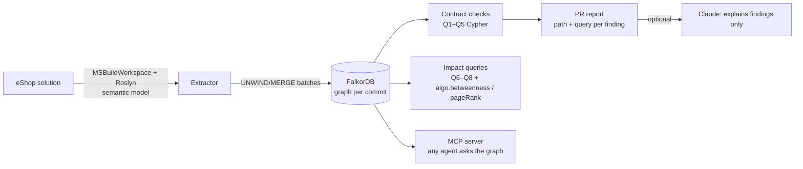

# Ripple

**Ripple finds the bugs your compiler can't: cross-service contract breaks in event-driven .NET.**

> *The diff is 3 lines. The blast radius is 3 services.*

Ripple is a pull-request review agent. It turns a .NET solution into a semantic code graph with Roslyn, stores it in
[FalkorDB](https://www.falkordb.com/), and traverses outward from a change to everything it can break — including
services that are only connected through a message bus. Every finding it reports carries the graph path that proves it
and the Cypher query that produced it.

Built for the [FalkorDB "Graph Hacks" hackathon](https://www.wemakedevs.org/hackathons/falkordb) (WeMakeDevs, Oct 2026).

---

## The problem

In [dotnet/eShop](https://github.com/dotnet/eShop) — Microsoft's reference microservices app — services talk through
integration events on RabbitMQ. Each service declares **its own copy** of every event it publishes or consumes:

```csharp
// Ordering.API — the publisher
public record OrderStockItem { public int ProductId { get; } public int Units { get; } ... }

// Catalog.API — a consumer, a different type in a different assembly
public record OrderStockItem(int ProductId, int Units);
```

The bus routes by the event's class name (`@event.GetType().Name`) and System.Text.Json matches fields by name. Nothing
ties the two `OrderStockItem` types together at compile time. So this PR to Ordering:

```diff
-    public int Units { get; }
+    public int Quantity { get; }
```

builds green, passes every unit test, and every diff-only reviewer approves it. In production:

- **Catalog.API** confirms stock for every order (it reads `Units` = 0 and checks `AvailableStock >= 0`) → oversells.
- **Catalog.API** calls `RemoveStock(0)` when an order is paid → stock never decreases.
- **Webhooks.API** forwards the paid event to external subscribers with `Units: 0`.

Ripple's comment on that PR:

```
### 1. `Catalog.API` — reads a field `OrderStatusChangedToPaidIntegrationEvent` no longer sends
(Ordering.API) OrderStatusChangedToPaidDomainEventHandler.Handle()
  -[:PUBLISHES]-> (:EventShape Ordering.API)
  -[:SHAPE_OF]-> (:EventContract {name: 'OrderStatusChangedToPaidIntegrationEvent'})
  <-[:SHAPE_OF]- (:EventShape Catalog.API)
  <-[:HANDLES]- (Catalog.API) OrderStatusChangedToPaidIntegrationEventHandler.Handle()
  -[:READS]-> (:Property {path: 'OrderStockItems[].Units'})  (missing in publisher's copy)
```

Diff-only reviewers can't see this, and neither can a plain call graph: there is no call edge from Ordering to
Catalog. The coupling only exists in the contract layer, which is what Ripple models.

---

## How it works



1. **Extract.** `MSBuildWorkspace` loads every deployable project (7 services + 7 libraries in eShop). A two-pass
   Roslyn walker emits structure (services, files, types, methods, calls) and the **contract layer**: each service's
   copy of each integration event as an `EventShape`, joined to a shared `EventContract` keyed by the routing name, with
   every field flattened to its JSON wire path (`OrderStockItems[].Units`, honouring `[JsonPropertyName]`,
   `[JsonIgnore]`, `[JsonInclude]`). `READS` edges come from the semantic model anywhere in the consuming service;
   `FORWARDS` marks handlers that hand the whole event to an untyped parameter (serialisation). Calls through
   interfaces, MediatR commands and MediatR domain events are added as `inferred` edges.
2. **Store.** Batched `UNWIND $rows … MERGE` writes into a staging graph, derived structure is computed in the graph
   (service projection + algorithm scores), then the staging graph is atomically `RENAME`d into place.
3. **Review a PR.** `ripple analyze` indexes the merge-base and the head commit into **two graphs**
   (`eshop@<sha>.<extractor build>`, cached), runs the same checks on both and reports what is new in head.
4. **Explain (optional).** One Claude call (`claude-opus-5-5`, structured JSON output) writes prose around the findings.
   It receives the numbered findings and the diff; explanations for findings the graph did not return are dropped, and
   the report always renders findings and paths from the graph. Without `ANTHROPIC_API_KEY` the text is a template.
5. **Agents.** An MCP server exposes the same queries as tools, so Claude Desktop / Claude Code / any MCP client can
   ask "what breaks if I change this field?".

---

## Graph data model

One FalkorDB graph per repository and commit.

### Nodes

| Label | Key (`key`) | Other properties | Layer |
|---|---|---|---|
| `Service` | assembly name | `name`, `kind` (`service`/`library`), `bridgeScore`, `dependencyRank` | code |
| `File` | repo-relative path | `path` | code |
| `Type` | `{assembly}\|{fqn}` | `fqn`, `name`, `kind`, `service`, `file` | code |
| `Method` | `{assembly}\|{fqn(params)}` | `fqn`, `name`, `signature`, `type`, `service`, `file`, `startLine`, `endLine`, `isPublic` | code |
| `EventContract` | event class name (= RabbitMQ routing key) | `name` | contract |
| `EventShape` | `{assembly}\|{event fqn}` — one service's copy | `fqn`, `name`, `service`, `file`, `line` | contract |
| `Property` | `{shape key}\|{json path}` | `path`, `name`, `type`, `wireType`, `jsonKind`, `settable`, `depth`, `file`, `line` | contract |

### Relationships

| Pattern | Meaning |
|---|---|
| `(Service)-[:CONTAINS]->(File)-[:DECLARES]->(Type)-[:HAS_METHOD]->(Method)` | structure |
| `(Type)-[:IMPLEMENTS {source}]->(Type)` | interfaces and base types inside the solution |
| `(Method)-[:CALLS {source, via}]->(Method)` | direct calls (`syntactic`); interface dispatch, MediatR `Send`/`Publish` and domain events (`inferred`, `via`) |
| `(Method)-[:PUBLISHES {line}]->(EventShape)` | the method creates the integration event |
| `(Method)-[:HANDLES]->(EventShape)` | `Handle` of an `IIntegrationEventHandler<T>` |
| `(Service)-[:SUBSCRIBES {handler}]->(EventContract)` | `eventBus.AddSubscription<TEvent, THandler>()` |
| `(EventShape)-[:SHAPE_OF]->(EventContract)` | a service's copy of a contract |
| `(EventShape)-[:HAS_PROPERTY]->(Property)` | the copy's JSON fields, nested paths flattened |
| `(Method)-[:READS {line, context}]->(Property)` | code reads the field (`context: log` inside logging calls) |
| `(Method)-[:FORWARDS {line, to}]->(EventShape)` | the whole event goes to an `object`/generic parameter |
| `(Type)-[:DEFINES_SHAPE]->(EventShape)` | the event's type node |
| `(Service)-[:DEPENDS_ON {contracts, weight}]->(Service)` | derived projection for graph algorithms |

On eShop: 1,786 nodes and ~3,100 edges, extracted and written in about 20 seconds.

---

## Cypher queries and graph algorithms

These are the exact strings in [`RippleQueries.cs`](src/Ripple.Core/Queries/RippleQueries.cs) (regenerate this section
with `ripple queries`).

<!-- QUERIES:BEGIN -->
<!-- QUERIES:END -->

---

## Evaluation

<!-- EVAL:BEGIN -->
<!-- EVAL:END -->

---

## Run it

Requirements: Docker, .NET 10 SDK.

```bash
docker compose up -d                       # FalkorDB on :6379, FalkorDB Browser on http://localhost:3000
git clone https://github.com/dotnet/eShop ../eshop
# eShop pins SDK 10.0.302; on another 10.0.x feature band, relax it:
sed -i 's/"version": "10.0.302"/"version": "10.0.100"/' ../eshop/global.json

dotnet run --project src/Ripple.Cli -- ingest  --repo ../eshop          # build graph 'eshop'
dotnet run --project src/Ripple.Cli -- check                            # contract checks on the whole repo
dotnet run --project src/Ripple.Cli -- selfcheck                        # EXPLAIN every query (see FalkorDB notes)

# Review a change: base vs head, markdown PR comment
dotnet run --project src/Ripple.Cli -- analyze --repo ../eshop --base main --head my-branch --markdown comment.md

# Benchmark
dotnet run --project src/Ripple.Cli -- eval --repo ../eshop --out eval
```

### MCP server

```json
{
  "mcpServers": {
    "ripple": {
      "command": "dotnet",
      "args": ["run", "--project", "/path/to/Graphhacks/src/Ripple.Mcp"],
      "env": { "FALKORDB": "localhost:6379", "RIPPLE_GRAPH": "eshop" }
    }
  }
}
```

Tools: `graph_schema`, `list_contracts`, `contract_breaks`, `what_breaks_if_field_changes`, `find_methods`,
`impact_of_method`, `service_risk`, `run_cypher` (read-only: `GRAPH.RO_QUERY`, FalkorDB rejects writes).

### In FalkorDB Browser

Open http://localhost:3000, select graph `eshop`, and run:

```cypher
MATCH p = (pub:Method)-[:PUBLISHES]->(:EventShape)-[:SHAPE_OF]->(c:EventContract {name: 'OrderStatusChangedToPaidIntegrationEvent'})
          <-[:SHAPE_OF]-(cs:EventShape)<-[:HANDLES]-(h:Method)-[:READS]->(:Property {path: 'OrderStockItems[].Units'})<-[:HAS_PROPERTY]-(cs)
RETURN p
```

---

## FalkorDB notes

While building Ripple we hit two query-planner issues in FalkorDB (module 60002); see
[`docs/falkordb-cartesian-repro.md`](docs/falkordb-cartesian-repro.md). The first one silently turned a type-drift
check into a cross product of unrelated contracts. Every Ripple query now projects with `WITH` after its first filter,
and `ripple selfcheck` runs `GRAPH.EXPLAIN` on all of them and fails if any plan contains a Cartesian Product.

---

## Limitations

- eShop-shaped event buses: integration events derive from `IntegrationEvent`, handlers implement
  `IIntegrationEventHandler<T>`, routing is by class name, System.Text.Json with no naming policy. Other buses
  (MassTransit, NServiceBus) need their own conventions.
- Reads are followed up to 3 `CALLS` hops from the handler; reads behind reflection, `dynamic`, positional
  deconstruction (`var (a, b) = evt`) or another queue hop are not seen.
- Enum member renames inside a string-serialised enum, global converters or naming policies registered at runtime,
  and `[JsonIgnore(Condition = …)]` are not modelled.
- Type compatibility is a fixed table of System.Text.Json defaults (`RippleQueries.Compatible`).

---

## Hackathon tracks

- **01 Agents That Act on Connected Data** — the PR agent, multi-hop impact, path-backed findings, MCP tools.
- **03 Company Brain** — the graph is a queryable map of which service depends on which contract and field.
- **02 Agent Memory and Coordination** — per-commit graphs give agents a versioned memory of the system's contracts.

## AI assistance disclosure

This project was built with AI coding assistance (Claude Code). It was used to write and refactor code (the Roslyn
extractor, Cypher queries, CLI, MCP server and evaluation harness), to run independent critical reviews at each
milestone, and to draft documentation. The design, the eShop analysis, the query set and every number in the evaluation
were checked by running them; the evaluation's raw outputs are in [`eval/`](eval/).
